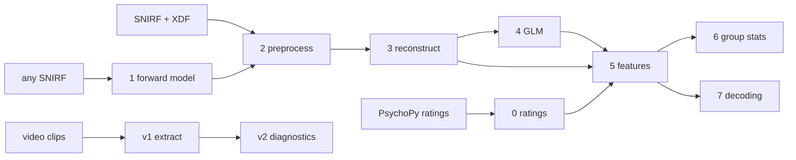

# hddot-video-interest

Analysis pipeline for whole-head **high-density diffuse optical tomography (HD-DOT)** recorded
while people watch short documentary clips and rate how interesting each one was. It takes raw
SNIRF + LSL recordings to cortical parcel time series, single-trial features, group statistics
and cross-validated decoding of interest. It also extracts the clips' audio-visual features.

Built on [cedalion](https://github.com/ibs-lab/cedalion). Developed for an MSc thesis at
Charité – Universitätsmedizin Berlin. **No data are included.**

## Study design the code assumes

- Continuous-wave HD-DOT, two wavelengths, events synchronised through LSL hardware pulses.
- Per session: 3 video blocks × 8 clips (~60 s each; rating after every clip) and 3 rest blocks.
- Every participant sees **the same clips in the same order**, so session + position identify
  a clip across people (`video_uid`). Up to 5 sessions per participant, different clips each.

All of this is configurable (`paradigm:` in the config); see [Adapting](#adapting-to-your-study).

## Pipeline



| step | script | runs | does | key output |
|---|---|---|---|---|
| 0 | `00_ratings.py` | once | parse ratings, clip ids, z-scores, normative rating | `group/ratings/ratings_all.csv` |
| 1 | `01_forward_model.py` | once | ICBM152 head model, montage registration, sensitivity | `forward_model/forward_model.pkl` |
| 2 | `02_preprocess.py` | per session | sync, motion correction, filtering, pruning, global regression | `preproc.pkl`, `events.csv` |
| 3 | `03_reconstruct.py` | per session | image reconstruction → parcels → parcel-space global regression | `parcels/<block>.nc` |
| 4 | `04_glm.py` | per session | single-trial GLM, area under the fitted response | `glm_auc.csv.gz` |
| 5 | `05_features.py` | once | model-free features + GLM AUC + ratings → tables | `group/features/*` |
| 6 | `06_group_stats.py` | once | three-level permutation tests, FDR, LME, reliability, power | `group/stats/*` |
| 7 | `07_decoding.py` | once | within-/cross-subject decoding, clip-identity control, corrected nulls, model comparison | `group/decoding/*` |
| v1 | `video/v1_extract_features.py` | once | luminance, contrast, flow, cuts, faces, bodies, speech, loudness, flux | `group/video_features/features/` |
| v2 | `video/v2_feature_diagnostics.py` | once | features as GLM regressors: correlation, VIF, variance left | `group/video_features/diagnostics/` |

What each step computes, with all parameters: [docs/methods.md](docs/methods.md).
Expected inputs and every output file: [docs/data_layout.md](docs/data_layout.md).

## Install

```bash
git clone https://github.com/psyarov/hddot-video-interest.git
cd hddot-video-interest
mamba env create -f environment.yml          # Python 3.11 + cedalion
mamba activate dotinterest
pip install -e .
pytest -q                                    # ~2 min, synthetic data only
```

Step 1 needs NIRFASTer or MCX (see cedalion's docs). The video steps use a separate
environment (`environment-video.yml`: torch, ultralytics, silero-vad, ffmpeg).

## Try it without data

`tests/synthetic.py` writes a small study in the layout of step 3 (10 subjects × 2 sessions,
cleaned parcel time series, events, ratings) with an interest effect planted in visual parcels.

```bash
python tests/synthetic.py --out demo/
python scripts/04_glm.py          --config demo/config.yaml
python scripts/05_features.py     --config demo/config.yaml
python scripts/06_group_stats.py  --config demo/config.yaml --n-perm 500 --no-parcels
python scripts/07_decoding.py     --config demo/config.yaml --n-perm 50 --n-perm-cross 50 \
                                  --models ridge,logreg,rf --sets B_mean_HbO,B_amplitude
```

`demo/derivatives/group/stats/summary_network.csv` should show the interest effect in
`VisCent_*` only; `group/decoding/positive_control.csv` should be near 1.

## Run on your data

```bash
cp config/config.example.yaml config/config.yaml        # edit paths (git-ignored)
cp config/sessions.example.csv config/sessions.csv      # your sessions (git-ignored)

python scripts/00_ratings.py       --config config/config.yaml
python scripts/01_forward_model.py --config config/config.yaml
python scripts/02_preprocess.py    --config config/config.yaml      # all sessions in turn
python scripts/03_reconstruct.py   --config config/config.yaml
python scripts/04_glm.py           --config config/config.yaml
python scripts/05_features.py      --config config/config.yaml
python scripts/06_group_stats.py   --config config/config.yaml
python scripts/07_decoding.py      --config config/config.yaml
```

Per-session scripts take `--only SUB:SES` (one session), `--index N` (N-th session; set
automatically from `SLURM_ARRAY_TASK_ID`) and `--overwrite`; finished sessions are skipped.
A session that fails is reported and the loop continues.

### On a SLURM cluster

```bash
N=$(python -m dotinterest.config config/config.yaml)               # last session index
J2=$(sbatch --parsable --array=0-$N slurm/session_array.sbatch 02_preprocess.py)
J3=$(sbatch --parsable --array=0-$N --dependency=aftercorr:$J2 slurm/session_array.sbatch 03_reconstruct.py)
J4=$(sbatch --parsable --array=0-$N --dependency=aftercorr:$J3 slurm/session_array.sbatch 04_glm.py)
sbatch --dependency=afterok:$J4 slurm/group.sbatch 05_features.py
```

Edit partitions, memory and the container line in `slurm/*.sbatch`. Rough cost for 567
channels and ~75 min sessions: step 2 ~1–2 h and 64 GB per session, step 3 ~1 h (GPU helps),
step 4 minutes; steps 6–7 hours at the default permutation counts.

## Repository layout

```
config/            config.example.yaml (every parameter), sessions.example.csv
src/dotinterest/   the library: io, paradigm, preprocessing, headmodel, recon, glm,
                   features, ratings, stats, decoding, video_features, parcels, config
scripts/           numbered pipeline steps (00–07) + video/ (v1–v2)
slurm/             job-array and single-job templates
tests/             synthetic study generator + tests
docs/              methods.md, data_layout.md
```

## Design choices worth knowing

- **Two global regressions** (channel space before, parcel space after reconstruction) remove
  systemic physiology; every map is then relative to the head average.
- **Subject is the unit of inference.** Single-trial OLS p-values are never used; group tests
  permute labels within session, the exchangeability the design licenses.
- **Corrected searches.** The decoding grid and the cross-subject feature sets are corrected as
  whole searches (max-statistic / min-p), not cell by cell.
- **Clip identity is a confound across people.** Identical clip order lets a cross-subject
  decoder succeed by recognising clips; `clip_blind` training removes that route.
- **Decoders.** Ridge / ridge classifier carry the permutation inference (closed form, so the
  whole search can be re-run thousands of times). Elastic net, PLS, SVR/SVM, random forest and
  logistic regression run through the same nested CV as a model comparison; pick them in
  `decoding.models` or with `--models`, and add any scikit-learn estimator in
  `dotinterest/decoding.py::sklearn_models`.
- **No feature selection outside CV folds.** Feature tables contain every parcel and family.

## Adapting to your study

- Different block structure or marker names: `paradigm:` in the config and
  `dotinterest/paradigm.py` (`block_limits`, `trial_table`).
- Different preprocessing: `preprocessing:` parameters, or edit `preprocess_session`.
- Interrupted or manually synchronised sessions: put an `events_override.csv` next to the raw
  data ([format](docs/data_layout.md#events_overridecsv)).
- Other head models / parcellations: `forward_model.head_model`; parcel labels must follow
  `<network>_..._<hemisphere>`.
- New targets for statistics or decoding: add a column to `group/features/trials.csv` and an
  entry to `CONTRASTS` (step 6) or `targets` (step 7).

## Citation

If you use this code, please cite the repository (and cedalion). A paper describing the
analysis is in preparation.

## License

MIT — see [LICENSE](LICENSE).
